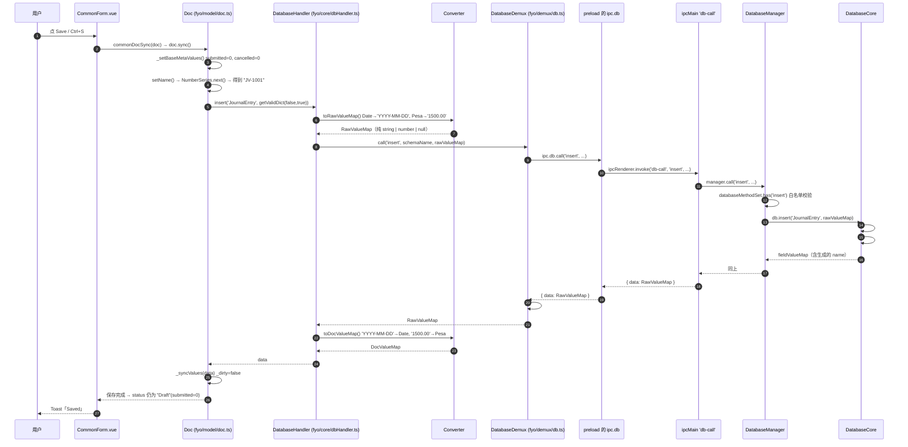

# Frappe Books 0.36.0 —「会计凭证单据草稿本地持久化 IPC 链路」逆向报告

对象：`app.asar`（Electron 打包产物，`name: frappe-books`, `version: 0.36.0`, AGPL-3.0-only）
范围：仅会计凭证（Journal Entry / 销售发票等单据）**草稿状态的本地持久化**链路，不涉及报表、打印、POS、ERPNext 同步等模块。
约束：全程只对 `app.asar` 本体做静态逆向，未查阅 Frappe Books 的 GitHub 源码。

---

## 0. 核心结论（先看这个）

**这个应用没有独立的「草稿自动保存」子系统。** 逆向得到的证据：

1. 主进程（`main.js`）里 **完全没有** `draft` 相关的标识符 —— `grep -i draft main.js` 零命中。
2. 渲染层里 `Draft` 只出现 8 次，**全部是状态标签**，不是存储逻辑。草稿语义来自 `fyo/model/doc.ts` 的两个内存标志位：

```569:600:recovered/renderer/fyo/model/doc.ts
  getValidDict(filterMeta = false, filterComputed = false): DocValueMap {
```

   以及 `getDocStatus()`（`recovered/renderer/models/helpers.ts:460`）：

   ```ts
   if (doc.notInserted) return 'Draft';   // 只在内存里，从未落盘
   if (doc.dirty)       return 'NotSaved'; // 改过但没保存
   if (!doc.schema?.isSubmittable) return 'Saved';
   return getSubmittableDocStatus(doc);    // 已保存未提交 → 'Draft'
   ```

   所以界面上那个灰色 **Draft** 徽标对应两种东西：
   - **`notInserted === true`**：单据只活在 `fyo.doc` 的内存缓存里，关掉表单就没了；
   - **已存在 SQLite、但 `submitted = 0`**：这才是用户真正理解的「草稿凭证」。

3. **没有自动保存**。渲染层不存在 `beforeunload` / `beforeRouteLeave` / `onBeforeRouteLeave` 钩子，`localStorage` 只用于汇率缓存（`currencyExchangeRate:*`）、最近搜索项（`recentKey`）和 `lastRoute`，electron-store 只存 `lastSelectedFilePath` / `files` / `deviceId` / `language`。

**因此「草稿本地持久化」= 通用单据写入链路**。凭证草稿的落盘走的是和任何已保存单据完全相同的一条 IPC 通道：`doc.sync()` → `fyo.db.insert/update` → `db-call` → 主进程 → SQLite。下面把它完整追踪出来。

---

## 1. 取证方法

| 步骤 | 手段 | 产物 |
| --- | --- | --- |
| 1 | asar 解包 | `extracted/main.js`、`extracted/main/preload.js`、`extracted/src/assets/index-DZZw8L_S.js`、`extracted/node_modules/` |
| 2 | 源码映射还原 | `extracted/**/*.js.map` 内嵌 `sourcesContent`，渲染层 **348 个原始 TS/Vue 源文件**被完整还原到 `recovered/renderer/`（`main.js.map` 无 `sourcesContent`，主进程部分靠 `main.js` 与 `sources` 清单交叉验证） |
| 3 | 通道枚举 | 正则扫描 `ipcMain.handle/on` 与 `preload.js` 的常量注释 |
| 4 | 行为验证 | 用 `recovered/` 源码 + `main.js` 谓词逻辑写出可运行复现件，跑通整条链路（§8） |

> `main.js.map` 的 `sources` 清单确认了主进程结构：`backend/database/core.ts`、`backend/database/manager.ts`、`backend/database/bespoke.ts`、`main/registerIpcMainActionListeners.ts`、`main/registerIpcMainMessageListeners.ts`。

---

## 2. Preload 脚本与 IPC 通道

### 2.1 Preload

`extracted/main/preload.js` 通过 `contextBridge.exposeInMainWorld('ipc', ipc)` 暴露一个名为 **`ipc`** 的全局对象。与本链路相关的部分：

```js
db: {
  getSchema()          { return ipcRenderer.invoke('db-schema', ...); },
  create(dbPath, cc)   { return ipcRenderer.invoke('db-create', ...); },
  connect(dbPath, cc)  { return ipcRenderer.invoke('db-connect', ...); },
  call(method, ...args){ return ipcRenderer.invoke('db-call', method, ...args); },
  bespoke(m, ...args)  { return ipcRenderer.invoke('db-bespoke', m, ...args); },
}
```

注意两点：

- **通道名是硬编码字符串**，旁边的 `/* DB_CALL */` 只是构建期 `const enum` 的内联注释（`"db-call" /* DB_CALL */`）。
- `ipc.store`（`electron-store`）**不经过 IPC**：preload 在渲染进程侧直接 `new Store()` 读写 `config.json`，所以 `store.get/set` 是同步的。

### 2.2 主进程全量通道（34 个）

`handle`（请求/响应，`invoke` 对应）：

```
check-db-access      check-for-updates    db-bespoke          db-call
db-connect           db-create            db-schema           delete-file
get-creds            get-db-default-path  get-db-list         get-env
get-language-map     get-templates        init-scheduler      open-dialog
print-html-document  save-data            save-dialog         save-html-as-pdf
select-file          send-api-request     send-error          show-error
show-message-box
```

`on`（单向，`send` 对应）：

```
close-main-window    isfullscreen-main-window  ismaximized-main-window
maximize-main-window minimize-main-window      open-external
open-menu            reload-main-window        show-item-in-folder
```

主进程 → 渲染进程的单向推送：

```
console-log    main-process-error    trigger-erpnext-sync
ismaximized-result    isfullscreen-result
```

**本链路涉及 4 个通道**：`db-schema`、`db-connect`、`db-call`（写入与读取都走它）、`db-bespoke`。

### 2.3 `db-call` 是唯一写入口，方法名白名单过滤

```53567:53577:extracted/main.js
var databaseMethodSet = /* @__PURE__ */ new Set([
  "insert", "get", "getAll", "getSingleValues", "rename",
  "update", "delete", "deleteAll", "close", "exists"
]);
```

```65462:65474:extracted/main.js
  async call(method, ...args) {
    if (!this.#isInitialized) {
      return;
    }
    if (!databaseMethodSet.has(method)) {
      return;
    }
    const response = await this.db[method](...args);
    if (method === "close") {
      delete this.db;
    }
    return response;
  }
```

`db-bespoke` 只允许 `BespokeQueries` 上的静态方法（`getLastInserted`、`getTopExpenses`、`getCashflow` 等，`extracted/main.js:64393`），凭证保存链路只在编号生成时用到 `getLastInserted`。

---

## 3. 完整时序：表单录入草稿 → SQLite

以「新建一张 Journal Entry（记账凭证）草稿并保存」为例。

```
渲染进程                                                     主进程
────────────────────────────────────────────────────────────────────────────────
[表单] CommonForm.vue
   │ 用户点 Save / 按 Ctrl+S
   ▼
commonDocSync(doc)                        utils/ui.ts:569
   │  (Ctrl+S 会先弹「Save …?」确认框；Save 按钮直接存)
   ▼
doc.sync()                                fyo/model/doc.ts:924
   ├─ _setBaseMetaValues()                写 createdBy/created/modified, submitted=0, cancelled=0
   ├─ _preSync() → _validateSync()
   ├─ setName(doc, fyo)                   fyo/model/naming.ts
   │     naming === 'numberSeries'
   │     └─ getSeriesNext('JV-', 'JournalEntry')
   │           ├─ fyo.doc.getDoc('NumberSeries','JV-')     ─┐
   │           └─ series.next()                             │ 触发一串子调用
   │                 ├─ db.get('NumberSeries','JV-')        │
   │                 ├─ db.exists('JournalEntry','JV-1001') │
   │                 └─ series.sync()  → db.update(...)     │
   │                                                        │
   ├─ getValidDict(false, true)          剔除 computed，取全字段（含 Table 子表）
   ▼
db.insert('JournalEntry', docValueMap)    fyo/core/dbHandler.ts:104
   └─ Converter.toRawValueMap()           ← 关键：把 DocValue 压成 IPC 可序列化值
   ▼
DatabaseDemux.call('insert', …)           fyo/demux/db.ts:63
   ▼
ipc.db.call('insert','JournalEntry',raw)  main/preload.js
   ▼
ipcRenderer.invoke('db-call', …)  ═══════▶ ipcMain.handle('db-call')  main.js
                                              ▼
                                     DatabaseManager.call('insert', …)  main.js:65462
                                              ▼  (白名单校验)
                                     DatabaseCore.insert()  main.js:64793
                                        ├─ #insertOne('JournalEntry', raw)
                                        │     若 raw.name 为空则 getRandomString()
                                        │     INSERT INTO "JournalEntry" (…非 Table 字段…)
                                        └─ #insertOrUpdateChildren(…, false)
                                              对 accounts 字段逐行：
                                                #prepareChild()  ← 填 parent/parentSchemaName/parentFieldname/idx
                                                INSERT INTO "JournalEntryAccount" (…)
                                             返回 fieldValueMap（含被补上的 name/子行 name）
   ◀══════════ { data: <RawValueMap> } ══════  (异常时 { error: {name,message,stack,code} })
   ▼
DatabaseDemux.#handleDBCall()             fyo/demux/db.ts:13  解包 error，返回 data
   ▼
Converter.toDocValueMap()                 日期→Date、金额→Pesa、附件→对象
   ▼
doc._syncValues(data)                     doc.ts:710  刷新内存态、_dirty=false
   ▼
doc.sync() 收尾 → doc._notInserted = false
```

`_insert()` / `_update()` 的分叉点：

```890:922:recovered/renderer/fyo/model/doc.ts
  async _insert() {
    this._setBaseMetaValues();
    await this._preSync();
    await setName(this, this.fyo);

    const validDict = this.getValidDict(false, true);
    let data: DocValueMap;
    try {
      data = await this.fyo.db.insert(this.schemaName, validDict);
    } catch (err) {
      throw await getDbSyncError(err as Error, this, this.fyo);
    }
    await this._syncValues(data);
    ...
  async _update() {
    await this._validateDbNotModified();
    this._updateModifiedMetaValues();
    await this._preSync();

    const data = this.getValidDict(false, true);
    ...
      await this.fyo.db.update(this.schemaName, data);
```

### 序列图（Mermaid）



---

## 4. 消息入参 / 返回结构

### 4.1 统一信封 `BackendResponse`

主进程每个 `handle` 内部都用 `getErrorHandledReponse` 包一层：

```53650:53663:extracted/main.js
async function getErrorHandledReponse(func) {
  const response = {};
  try {
    response.data = await func();
  } catch (err) {
    response.error = {
      name: err.name,
      message: err.message,
      stack: err.stack,
      code: err.code
    };
  }
  return response;
}
```

所以线上永远是这两种形状之一：

```jsonc
{ "data": <任意可序列化结果> }                       // 成功（可能 data === undefined）
{ "error": { "name": "...", "message": "...", "stack": "...", "code": "..." } }
```

渲染侧的解包（**只看 `error.name` 是否存在**）：

```13:25:recovered/renderer/fyo/demux/db.ts
  async #handleDBCall(func: () => Promise<BackendResponse>): Promise<unknown> {
    const response = await func();

    if (response.error?.name) {
      const { name, message, stack } = response.error;
      const dberror = new DatabaseError(`${name}\n${message}`);
      dberror.stack = stack;

      throw dberror;
    }

    return response.data;
  }
```

> ⚠️ 注意：`DatabaseError` 的 `message` 被拼成 `"$ {name}\n$ {message}"`，且 `stack` 被替换成主进程的栈 —— 渲染层看到的错误栈其实来自另一侧。

### 4.2 逐通道契约

| 通道 | 方向 | 入参 | 返回 |
| --- | --- | --- | --- |
| `db-schema` | `invoke` | 无 | `{ data: SchemaMap }` |
| `db-create` | `invoke` | `dbPath: string, countryCode?: string` | `{ data: string }`（生效的 countryCode） |
| `db-connect` | `invoke` | `dbPath: string, countryCode?: string` | `{ data: string }` |
| **`db-call`** | `invoke` | **`method: DatabaseMethod, ...args`** | `{ data: unknown }` / `{ error }` |
| `db-bespoke` | `invoke` | `method: string, ...args` | `{ data: unknown }` / `{ error }` |

`db-call` 在**写草稿**时的具体实参（`recovered/renderer/fyo/core/dbHandler.ts:104`）：

```js
// insert
ipc.db.call('insert', 'JournalEntry', rawValueMap)          // → { data: rawValueMap }
// update（注意返回 undefined）
ipc.db.call('update', 'JournalEntry', rawValueMap)          // → { data: undefined }
// 读取
ipc.db.call('get', 'JournalEntry', 'JV-1001', undefined)    // → { data: rawValueMap }
ipc.db.call('exists', 'JournalEntry', 'JV-1001')            // → { data: boolean }
// 名称生成用
ipc.db.bespoke('getLastInserted', 'SalesInvoice')           // → { data: number }
```

### 4.3 主进程侧的落库语义（`main.js:64793`）

```64793:64800:extracted/main.js
  async insert(schemaName, fieldValueMap) {
    if (this.schemaMap[schemaName].isSingle) {
      await this.#updateSingleValues(schemaName, fieldValueMap);
    } else {
      await this.#insertOne(schemaName, fieldValueMap);
    }
    await this.#insertOrUpdateChildren(schemaName, fieldValueMap, false);
    return fieldValueMap;
  }
```

- `#insertOne`（`main.js:65190`）：`name` 为空时用 `getRandomString()` 补一个；只取 **非 Table、非 computed** 的字段拼 `INSERT`。
- `#prepareChild`（`main.js:65145`）：子行 `name ??= getRandomString()`，并**无条件覆写** `parent / parentSchemaName / parentFieldname`，`idx ??= 序号`。
- `#updateOne`（`main.js:65288`）：拷贝 map → 删 `name` → 删 Table/computed 字段 → `WHERE name = ?` 更新；`undefined` 值在 knex + `useNullAsDefault: true` 下会写成 `NULL`。
- update 分支会调 `#insertOrUpdateChildren(…, true)`：子行按 `exists(target, child.name)` 决定 update 还是 insert，最后 `#runDeleteOtherChildren` 删掉本次没出现的子行（据此实现表格行的增/改/删）。

---

## 5. 草稿 JSON 数据结构

### 5.1 Schema 装配

`schemas/schemas.ts` 的 `getSchemas()` 依次做 `addMetaFields` → `removeFields` → `setSchemaNameOnFields` → `addCustomFields` → `deepFreeze`。其中：

- `addMetaFields`：`isSubmittable` → 追加 `submitted, cancelled` + base（`createdBy, modifiedBy, created, modified`）；`isChild` → 只追加 `idx, parent, parentSchemaName, parentFieldname`；其他 → base。
- `addNameField`（`main.js:60758`）：所有非 Single 且没有 `name` 字段的 schema，**`unshift` 一个 `NAME_FIELD`**（`{fieldname:'name', label:'ID', fieldtype:'Data', required:true, readOnly:true}`）。子表也有 `name` 主键列，这是子行能按 name 做 upsert 的前提。

### 5.2 凭证（JournalEntry）字段

来自 `extracted/main.js:55975`（`schemas/app/JournalEntry.json`）：

| 字段 | 类型 | 约束 |
| --- | --- | --- |
| `name` | Data | 主键，只读，`naming: "numberSeries"` 生成 |
| `numberSeries` | Link → NumberSeries | 必填，默认 `"JV-"` |
| `entryType` | Select | 必填（Journal Entry / Bank Entry / … / Depreciation Entry） |
| `date` | Date | 必填 |
| `accounts` | **Table → JournalEntryAccount** | 必填 |
| `referenceNumber` / `referenceDate` / `userRemark` / `attachment` | Data / Date / Text / Attachment | 选填 |
| `submitted`, `cancelled` | Check | meta，插入时置 `0/0` |
| `createdBy`, `modifiedBy`, `created`, `modified` | meta | 插入时填充 |

子表 `JournalEntryAccount`：`account`(Link→Account, 必填) / `debit`(Currency) / `credit`(Currency) + `tableFields:["account","debit","credit"]`。

### 5.3 过 IPC 的真实载荷（复现件实测抓包）

`db-call` 的 `insert` 实参 —— 已经是 Converter 压平后的 `RawValueMap`：

```json
{
  "name": "JV-1001",
  "numberSeries": "JV-",
  "entryType": "Journal Entry",
  "date": "2026-10-13",
  "accounts": [
    { "name": "wLXlfxZ5wm", "account": "Cash",  "debit": "1500.00", "credit": "0.00",
      "idx": 0, "parent": "Ym_g_McfoL", "parentSchemaName": "JournalEntry", "parentFieldname": "accounts" },
    { "name": "w8VRBQEAzw", "account": "Sales", "debit": "0.00", "credit": "1500.00",
      "idx": 1, "parent": "Ym_g_McfoL", "parentSchemaName": "JournalEntry", "parentFieldname": "accounts" }
  ],
  "referenceNumber": null,
  "referenceDate": null,
  "userRemark": "October adjustment",
  "attachment": null,
  "submitted": 0,
  "cancelled": 0,
  "createdBy": "Administrator",
  "modifiedBy": "Administrator",
  "created": "2026-10-13T05:47:13.766Z",
  "modified": "2026-10-13T05:47:13.766Z"
}
```

**几个必须注意的序列化细节：**

| 字段类型 | DocValue（渲染内存） | RawValue（过 IPC / 入库） |
| --- | --- | --- |
| Date | `Date` 对象 | `"2026-10-13"`（`toISODate()`，**本地日历日**） |
| Datetime | `Date` 对象 | `"2026-10-13T05:47:13.766Z"`（`toISOString()`） |
| Currency | Pesa/Money 实例 | `"1500.00"`（**字符串**，`money.store`） |
| Check | `boolean` | `0` / `1`（**数字**） |
| Int / Float | `number` | `number` |
| Attachment | 解析后的对象 | `JSON.stringify(...)` 字符串 |
| Link | `string` | `string`，空串会被归一成 `null` |

这就是为什么必须有 `fyo/core/converter.ts` 这一层：`Pesa` 是**类实例**，Electron 的结构化克隆会丢掉原型，到主进程只剩 `{store: "1500.00"}`。`Date` 虽然能过克隆，但主进程要写的是 SQLite 文本列，所以统一在渲染侧格式化。

复现件里用真实 `MessagePort` 做了对照实验（`run.js` 的 STEP 6）：

```
sent Date            -> received Date(2026-10-12T16:00:00.000Z)   # 原型保留
sent Money instance  -> received {store: "1500.00"}               # 原型丢失
sent "2026-10-13"    -> received "2026-10-13"                     # 原样
```

### 5.4 落库后的行（`SQLite` 实读）

```json
// JournalEntry
{"name":"JV-1001","numberSeries":"JV-","entryType":"Journal Entry","date":"2026-10-13",
 "referenceNumber":null,"referenceDate":null,"userRemark":"October adjustment (revised)",
 "attachment":null,"submitted":0,"cancelled":0,"createdBy":"Administrator",
 "modifiedBy":"Administrator","created":"2026-10-13T05:47:21.704Z","modified":"2026-10-13T05:47:21.726Z"}

// JournalEntryAccount（parent 已被主进程覆写为真实凭证号）
{"name":"wp4YkSKEvy","account":"Cash","debit":"1500.00","credit":"0.00","idx":0,
 "parent":"JV-1001","parentSchemaName":"JournalEntry","parentFieldname":"accounts"}

// NumberSeries（编号计数器，也靠同一条 IPC 链路持久化）
{"name":"JV-","start":1001,"padZeros":4,"referenceType":"JournalEntry","current":1001,...}
```

**子表 `parent` 的两段式赋值是个有意思的细节**：渲染侧 `_getChildDoc` 用 `??=` 先塞了**临时** parent（当时 `doc.name` 还是随机串 `Ym_g_McfoL`），主进程 `#prepareChild` 再**无条件**覆盖成最终的单据号 `JV-1001`。所以抓包看到的 parent 是错的，最终入库是正确的。

---

## 6. 数据库存储路径

### 6.1 默认路径

```65944:65960:extracted/main.js
  import_electron5.ipcMain.handle(
    "get-db-default-path" /* GET_DB_DEFAULT_PATH */,
    async (_, companyName) => {
      let root;
      try { root = import_electron5.app.getPath("documents"); }
      catch { root = import_electron5.app.getPath("userData"); }
      if (main.isDevelopment) { root = "dbs"; }
      const dbsPath = import_path9.default.join(root, "Frappe Books");
      const backupPath = import_path9.default.join(dbsPath, "backups");
```

- 生产：`<Documents>/Frappe Books/<公司名>.books.db`
- 备份目录：`<Documents>/Frappe Books/backups/`
- 开发：`dbs/Frappe Books/...`
- 重名时弹「Overwrite / New」，选 New 则追加 ISO 时间戳后缀：`<公司名>_20261013T054713766.books.db`

### 6.2 实际打开的文件来自 electron-store

`get-db-list` → `setAndGetCleanedConfigFiles()`（`main.js:53618`）读取 `config.json` 的 `files` 数组，并**剔除磁盘上已不可写（`fs.access(..., W_OK)` 失败）的条目**后回写：

```js
[{ id, dbPath, companyName, openCount }]
```

启动时恢复上次库：`App.vue:149` 读 `fyo.config.get('lastSelectedFilePath')` → `fileSelected(path)`（`recovered/renderer/src/App.vue`）。

### 6.3 连接与表结构

`DatabaseCore`（`main.js:64681`）用 **better-sqlite3 + knex**：

```js
this.connectionParams = {
  client: "better-sqlite3",
  connection: { filename: this.dbPath },
  useNullAsDefault: true,
  asyncStackTraces: process.env.NODE_ENV === "development"
};
// connect(): await this.knex.raw("PRAGMA foreign_keys=ON")
```

表名 = `schemaName`（`JournalEntry`、`JournalEntryAccount`…），`name` 为主键；Link 字段建 `foreign key … references "T"("name") on update cascade on delete restrict`；`isSingle` 的 schema 不建表，字段以键值对存进 `SingleValue(parent, fieldname, value)`。

---

## 7. 保存触发逻辑（**没有自动保存**）

触发 `doc.sync()` 的路径只有三条：

| # | 触发点 | 位置 | 行为 |
| --- | --- | --- | --- |
| 1 | 表单 Save 按钮 | `CommonForm.vue:69` `<Button @click="sync">` | `commonDocSync(doc)` → **静默保存** |
| 2 | `Ctrl/Cmd + S` | `src/utils/vueUtils.ts:162` | `commonDocSync(doc, true)` → **先弹「Save …?」确认框** |
| 3 | 程序化调用 | POS / SetupWizard / ImportWizard / ChartOfAccounts 等 | 直接 `await doc.sync()` |

```162:172:recovered/renderer/src/utils/vueUtils.ts
    shortcuts.pmod.set(context, ['KeyS'], syncOrSubmitCallback, false);
    shortcuts.pmod.set(context, ['Backspace'], cancelOrDeleteCallback, false);
```

字段级输入只改内存，不落盘：

```js
async onValueChange(field, value) {          // CommonForm.vue
  await this.doc.set(fieldname, value);      // 只置 _dirty = true
}
```

**离开表单时的处理**（这里容易误判，需分清）：

- 页面头部的返回按钮 `PageHeaderNavGroup.vue:17` 就是裸的 `$router.back()`，**没有任何清理或保存钩子**。所以从 Journal Entry / 发票这类 `CommonForm` 返回，未保存的内存草稿只是留在 `fyo.doc` 缓存里 —— 不写盘，也不显式丢弃；App 重启即彻底消失。
- 唯一显式丢弃的是 QuickEdit 表单（`src/pages/QuickEditForm.vue:254`）：

```js
async routeToPrevious() {
  if (this.doc?.dirty && this.doc?.inserted) {
    await this.doc.load();                 // 已入库 → 从库里回滚内存
  }
  if (this.doc && this.doc.notInserted) {
    await this.doc.delete();               // 未入库 → 直接扔掉
  }
  this.$router.back();
}
```

**结论：草稿不会因为你编辑就自动写盘。** 用户必须显式保存；未保存的新单据只存在于内存，重启即失去。所谓「草稿本地持久化」的实际边界就是「已保存、未提交（`submitted=0`）」这一状态。

### 并发保护

`_update` 前置一个乐观锁检查（`doc.ts:763`）：把内存里的 `modified` 与库里读回的 `modified` 用 `toISOString()` 比对，不一致抛 `ConflictError`（提示 "has been modified after loading please reload entry"）。

---

## 8. 可独立运行的 JS 重实现

代码在 **`reimpl/`**，零外部依赖（用 Node 22 内置 `node:sqlite` 替代 knex + better-sqlite3；用 `worker_threads` 的 `MessageChannel` 复现真实的进程边界与结构化克隆约束）。

### 8.1 文件与对应关系

| 文件 | 对应原始模块 |
| --- | --- |
| `schema.js` | `schemas/schemas.ts`（含 `addMetaFields` / `addNameField` / `NAME_FIELD`） |
| `converter.js` | `fyo/core/converter.ts`（逐字段类型搬运，含 Pesa 的极简实现） |
| `luxon-lite.js` | 渲染包里内联的 luxon（只用 `fromISO`/`fromJSDate`/`toISODate`/`toJSDate`） |
| `core.js` | `backend/database/core.ts`（`insert/update/delete/get/getAll/exists` + `#insertOne`/`#prepareChild`/`#insertOrUpdateChildren`/`#updateOne`/`#runDeleteOtherChildren`） |
| `db-manager.js` | `backend/database/manager.ts`（`databaseMethodSet` 白名单 + `call`/`callBespoke`） |
| `main-process.js` | `main/registerIpcMainActionListeners.ts`（`db-schema`/`db-connect`/`db-call`/`db-bespoke` + `getErrorHandledReponse`） |
| `preload.js` | `main/preload.ts` 的 `db` 命名空间 |
| `ipc.js` | Electron `ipcMain`/`ipcRenderer` 的最小替代（真实进程边界） |
| `db-handler.js` | `fyo/demux/db.ts` + `fyo/core/dbHandler.ts` |
| `draft-doc.js` | `fyo/model/doc.ts` + `fyo/model/naming.ts` + `fyo/models/NumberSeries.ts` + `getDocStatus` |
| `renderer.js` | 表单侧驱动脚本（worker 线程） |
| `run.js` | 主进程入口 |
| `inspect.js` | 用独立连接检查产出的 `.db` |

### 8.2 运行

```bash
cd reimpl
node run.js                 # SQLite 用 :memory:
node run.js /tmp/jv.db      # 落盘，可用任意 SQLite 客户端检查
node inspect.js /tmp/jv.db  # 独立连接 dump 各表 + JournalEntry DDL
```

### 8.3 实测输出（节选）

```
STEP 1  Form entry creates an in-memory draft (nothing on disk yet)
   notInserted=true  dirty=true  status="Draft"
   name=Ym_g_McfoL   (no id assigned until the insert runs)

STEP 2  Ctrl+S / Save button -> doc.sync() -> _insert()
   [main] db-call("exists") args=["NumberSeries", "JV-"]
   [main] db-call("insert") args=["NumberSeries", {... "current":0 ...}]
   [main] db-call("exists") args=["JournalEntry", "JV-1001"]
   [main] db-call("update") args=["NumberSeries", {... "current":1001 ...}]
   [main] db-call("insert") args=["JournalEntry", {... 完整载荷 ...}]
   name=JV-1001  inserted=true  status="Draft"

STEP 3  Edit the saved draft (in-memory dirty flag only)
   dirty=true  status="NotSaved"

STEP 4  Save again -> doc.sync() -> _update()
   [main] db-call("update") args=["JournalEntry", {...}]
   dirty=false  status="Draft"

STEP 5  Re-read from SQLite through a cold doc cache (load())
   name=JV-1001  entryType=Journal Entry
   date=2026-10-12T16:00:00.000Z  (本地午夜 2026-10-13)
   userRemark="October adjustment (revised)"  status="Draft"
   accounts=Cash dr=1500.00 cr=0.00 idx=0 | Sales dr=0.00 cr=1500.00 idx=1
```

产出的 DDL（与原程序 `#buildColumnForTable` 的规则一致）：

```sql
CREATE TABLE "JournalEntry" (
  "name" text primary key not null, "numberSeries" text default 'JV-' not null,
  "entryType" text not null, "date" date not null, "referenceNumber" text,
  "referenceDate" date, "userRemark" text, "attachment" text,
  "submitted" boolean not null, "cancelled" boolean not null,
  "createdBy" text not null, "modifiedBy" text not null,
  "created" datetime not null, "modified" datetime not null,
  foreign key ("numberSeries") references "NumberSeries"("name")
    on update cascade on delete restrict
);
```

---

## 9. 逆向中发现的值得注意的行为

1. **`db-call` 静默丢弃非法方法**：方法名不在白名单时 `call()` 返回 `undefined`，通道信封是 `{ data: undefined }`，**渲染侧不会报错**，只是拿到 `undefined`。未初始化（`#isInitialized === false`）时同理。
2. **`update` 不返回数据**：`DatabaseCore.update()` 无返回值，所以 `{ data: undefined }`，`DatabaseHandler.update()` 也确实没接返回值。
3. **`Currency` 存成 TEXT**：金额在库里是字符串 `"1500.00"`，不是 REAL。`sqliteTypeMap` 里 `Currency: "text"`。
4. **`Check` 存成数字**：`boolean` 列类型，写 `0/1`；`toRawCheck` 把 `true` → `1`。
5. **Date 与 Datetime 语义不同**：Date 用 `toISODate()`（本地日历日，跨时区可能"差一天"），Datetime 用 `toISOString()`（UTC）。
6. **`name` 在两处生成**：渲染侧 `_getChildDoc` / `getTemporaryName` 先给临时随机名，主进程 `#insertOne` 兜底 `getRandomString()`，父单据的正式号由 `NumberSeries` 计数器产生（`JV-` + `padZeros:4` → `JV-1001`），且 `checkIfCurrentExists` 会撞号自增。
7. **子表 `parent` 被覆写**：见 §5.4。
8. **`useNullAsDefault: true` 的副作用**：`update` 时载荷里缺的（或值为 `undefined` 的）字段会被写成 `NULL`，而不是保持原值。
9. **preload 的 `ipc.store` 绕过 IPC**：`electron-store` 的 `get/set` 直接从渲染进程读写 `config.json`，因此它**不是**一个可靠的跨进程同步点（主进程和渲染进程各持一份内存副本）。
10. **错误栈被替换**：渲染层 `DatabaseError.stack` 用的是主进程 `err.stack`。

---

## 10. 覆盖范围与局限

**已确认**：preload 与通道名、`db-call` 全链路时序、草稿语义来源（`notInserted`/`dirty`/`submitted`）、载荷结构与类型转换规则、SQLite 文件路径推导、保存触发点、无自动保存。

**未展开**（超出本次范围）：migration/patch 流程（`#getCreateAlterList`、`runPatches`）、`SingleValue` 的 Singles 初始化、自定义字段（`addCustomFields`）、ERPNext 同步队列、knex 具体生成的 SQL 方言细节。主进程没有 `sourcesContent`，主进程侧结论均来自 `main.js` 反混淆代码 + `sources` 清单交叉验证，而非原始 TS。
